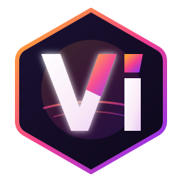
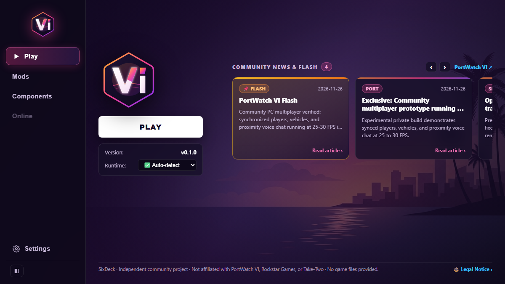

<p align="center">
  
</p>

<h1 align="center">SixDeck</h1>

<p align="center">
  <b>Open-Source Community Desktop Launcher, Runtime Manager &amp; Modding Hub</b><br/>
  <i>Handed over to the open-source community — fork it, improve it, optimize it, and make it yours.</i>
</p>

<p align="center">
  
</p>

---

## Important Notices & Disclaimers

> **Not an Official PortWatch VI Project**
> **SixDeck** is an independent, community-built project and is **not an official PortWatch VI application**, nor is it maintained or endorsed by the PortWatch VI team. It reads publicly available PortWatch VI community JSON feeds strictly as a reference. Full credit for community tracking data belongs to PortWatch VI and its contributors.

> **Independent Community Project — No Game Files Included**
> SixDeck is **not affiliated with, endorsed by, sponsored by, or connected to Rockstar Games, Take-Two Interactive**, or any of their subsidiaries.
> This repository and its builds **do not contain, host, distribute, or link to** any copyrighted game copies, game executables, encryption keys, or commercial assets. Users must legally obtain and import their own local dump directory.

> **Gifted to the Community (MIT License)**
> This prototype is released freely to the community so developers, tinkerers, and contributors can take it further, clean up the architecture, improve performance/stability, add runtime support, and turn it into an optimal, fully functional community launcher.

> **AI Transparency**
> **AI Used:** `Gemini 4 Neon` / `Antigravity IDE`

---

## Features

- **Direct Runtime Launching**: Auto-discovers locally compiled open-source runtimes (`cool_fox`, `ScarlettPort`, `VIctory`, `VItoriaBr`, `ztrx-victory`, `xcl`, and local `LAB` builds) and launches them directly with configurable profiles (no extra wrapper UI required).
- **Live Telemetry & Crash Reporter**:
  - Live FPS / draw-call counter and one-click **`STOP GAME`** button.
  - Automatic copyable **Crash Log Popup** capturing the last seconds of ANSI-cleaned logs and exit code (`0x...`) on unexpected runtime exits.
- **Graphics, Shaders & Save Management**:
  - Configurable **FPS Limit**, **Resolution**, **Render Scale**, **Console Profile**, **Ray Tracing**, and **GPU Profile** (`NVIDIA` / `AMD` / `ALL`).
  - Background **Shader Prewarm** runner and timestamped ZIP **Save Slots Backup / Restore**.
  - Live **System RAM & Commit** monitor with low-memory warnings.
- **Local Dump Verification**:
  - Guided **Import Dump** folder picker (auto-resolving nested dump subfolders and verifying `game_scarlett_master.exe` + `.rpf` count).
- **Components & Startup Update Control**:
  - `PLAY` button stays ready by default; optional **Check Updates on Startup** toggle switches to `UPDATE` only when newer critical component revisions are not yet downloaded/compiled locally.
  - Version diff preview, Windows Defender scanning on downloads, and **N-1 Rollback** support.
- **Mods Workshop (17+ Open-Source Sources)**:
  - Curated + live PortWatch VI open-source modding tools (`OpenVI`, `SixNG`, `forge9`, `Rage Tools VI`, `PercyStar`, `rpf9-explorer`, `TTPF Studio`, `BCPack-RS`, `Vice Lens`, `RageForge`, `rage9-re`, `AWC Audio Extractor`, `OpenRAGE`, `6stars`, etc.) with category filtering, search, load-order controls, and Vanilla mode toggle.
- **Online Tab (Coming Soon...)**:
  - Tracks verified community multiplayer breakthroughs, X video clips, and online modding ecosystem reports.
- **Clean Desktop UX**:
  - Fixed 16:9 `pywebview` window (`1200×675`), startup logo splash animation, collapsible icon-only sidebar, zero background CMD popup flashes (`CREATE_NO_WINDOW`), and 100% original artwork (`Assets/logo.svg`, `Assets/BG.png`, `Assets/launcher_icon.ico`).

---

## Quick Start (From Source)

### Requirements
- Windows 10 / 11 (x64)
- Python **3.11+** (tested on Python 3.13)
- Microsoft Edge WebView2 Runtime (pre-installed on Windows 11)

### Setup & Run
```powershell
python -m venv .venv
.\.venv\Scripts\Activate.ps1
pip install -r requirements.txt

# Optional: copy .env.example to .env if you want a GitHub API token (higher rate limits)
Copy-Item .env.example .env

# Launch SixDeck desktop app
python launcher_app.py
```

### Build Standalone `SixDeck.exe`
```powershell
.\build_exe.ps1
```
This builds a standalone single-file Windows executable at `dist\SixDeck.exe` (and copies it to `SixDeck.exe`) with bundled UI, original artwork, and multi-resolution Win32 icon.

### Run Automated Tests
```powershell
python -m pytest -W default -q
```

---

## Project Structure

```text
SixDeck/
├── launcher_app.py       # Desktop pywebview entry point & Win32 icon setup
├── gui.py                # Local HTTP API server, runtime launcher, crash capture & sync
├── launcher_ui.html      # Single-page launcher UI (Play, Mods, Components, Online, Settings)
├── silent_watch.py       # Optional headless scheduled-task scanner
├── config.yaml           # Discovery keywords, relevance scoring & source rules
├── Assets/               # 100% original vector logo, Win32 ICO & dusk wallpaper
├── src/
│   ├── config.py         # Config & environment loader
│   ├── models.py         # Pydantic data models
│   ├── storage.py        # Local SQLite database
│   ├── filters/          # Anti-spam & technical relevance filter
│   ├── notifiers/        # Windows toast & Markdown reports
│   ├── sandbox/          # Safe download quarantine, SHA-256 & Defender scan
│   ├── scrapers/         # GitHub, PortWatch VI, forums, RSS & alt-git scrapers
│   └── utils/            # Mods manager, environment check, role classifier, status analyzer
├── tests/                # Pytest test suite
├── build_exe.ps1         # PyInstaller build script
└── LICENSE               # MIT License
```

---

## Contributing

This project was created as a community starter and is handed over freely to anyone who wants to improve it. Ideas for community PRs & forks:
- Refactoring `gui.py` into clean FastAPI/Starlette blueprints & removing legacy fallback HTML.
- Automated build pipelines (Rust/Cargo or release artifact fetchers) for open-source runtimes.
- Per-runtime mod/patch loader integration once community runtime hooks stabilize.
- Linux / Steam Deck compatibility layer support.

Feel free to fork, open PRs, or strip and reuse any component under the [MIT License](LICENSE).
