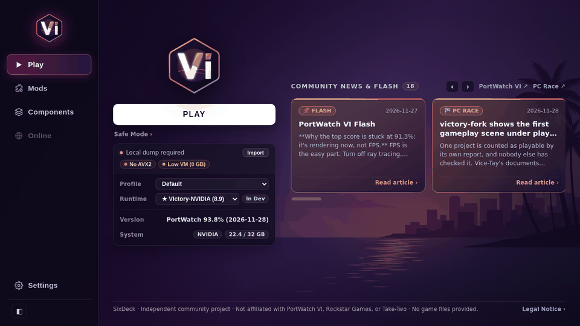

<p align="center">
  
</p>

<h1 align="center">SixDeck</h1>

<p align="center">
  <b>Open-Source Community Desktop Launcher, Runtime Manager &amp; Modding Hub</b><br/>
  <i>Handed over to the open-source community — fork it, improve it, optimize it, and make it yours.</i>
</p>

<p align="center">
  
</p>

---

## Important Notices, Acknowledgements & Disclaimers

> **Inspired by & Crediting Lumen**
> Several pre-flight diagnostics, hardware safety checks, portable upscaler/Agility SDK utilities, shader prewarm telemetry, and Linux/Windows runtime launch improvements in SixDeck were inspired by **[Lumen](https://gitgud.io/RedSyl/Lumen)** (by **RedSyl**). Full credit to the Lumen project for pioneering clean hardware-aware launch ergonomics for the community.

> **Not an Official PortWatch VI Project**
> **SixDeck** is an independent, community-built project and is **not an official PortWatch VI application**, nor is it maintained or endorsed by the PortWatch VI team. It reads publicly available PortWatch VI community JSON feeds strictly as a reference. Full credit for community tracking data belongs to PortWatch VI and its contributors.

> **Independent Community Project — No Game Files Included**
> SixDeck is **not affiliated with, endorsed by, sponsored by, or connected to Rockstar Games, Take-Two Interactive**, or any of their subsidiaries.
> This repository and its builds **do not contain, host, distribute, or link to** any copyrighted game copies, game executables, encryption keys, or commercial assets. Users must legally obtain and import their own local dump directory.

> **Gifted to the Community (MIT License)**
> This project is released freely to the community so developers, tinkerers, and contributors can take it further, clean up the architecture, improve performance/stability, add runtime support, and turn it into an optimal, fully functional community launcher.

> **AI Transparency**
> **AI Used:** `Gemini 4 Neon` / `Antigravity IDE`

---

## Features

- **Direct Runtime Launching & Hardware-Aware Suggestions**:
  - Auto-discovers locally compiled open-source runtimes (`cool_fox`, `ScarlettPort`, `VIctory`, `VItoriaBr`, `ztrx-victory`, `xcl`, and local `LAB` builds) and highlights the **Suggested for your PC** runtime directly inside the Play runtime dropdown.
  - Supports isolated **Profiles**, emergency **Safe Mode**, and direct headless CLI launching (`--launch`, `--safe-mode`, `--hardware`, `--prewarm`, `--fetch-sdk`).
- **Pre-Flight Hardware Diagnostics & Optimization (Lumen-inspired)**:
  - Automatic detection of **GPU**, **Physical RAM & Pagefile/Swap** (low virtual memory warnings), **CPU AVX2 support**, **Admin/Root NVIDIA shader cache issues**, and **Windows/Linux Proton (`umu-run` / Wine)** compatibility.
  - Laptop **battery guard** for High Performance power plans and automatic Windows `UserGpuPreferences` high-performance GPU assignment.
  - Generic **`MicrosoftGame.Config`** XML dump resolver (with path-traversal protection) and optional SHA-256 dump verification.
- **Shaders, Portable Upscaler SDKs & Graphics Presets**:
  - Multi-phase resumable **Shader Prewarm** with learned ETA (`data/timings.json`) and exact `PLAY` environment parity.
  - Built-in **Portable NVIDIA DLSS / AMD FSR 3 SDK** inspection & fetcher and **Microsoft D3D12 Agility SDK (1.620.2)** fetcher.
  - Curated performance & Superbuild presets (`16 GB Fast`, `Ultra-Low RAM`, `Series X Target`, `Balanced`, `Steam Deck`, etc.) plus timestamped ZIP **Save Slots Backup / Restore**.
- **Live Telemetry & Crash Reporter**:
  - Live FPS / draw-call counter and one-click **`STOP GAME`** button.
  - Automatic copyable **Crash Log Popup** with ANSI-cleaned logs and decoded **Windows NTSTATUS** exit codes (`0xC0000005`, `0xC000001D`, etc.).
- **Components & Live Trackers**:
  - Clean two-tab layout (**Installed & Updates** + **Live Trackers** merging PortWatch VI & PC Race feeds) with GitHub, Codeberg, GitLab, and `gitgud.io` mirror support.
  - SHA-256 verification, optional Windows Defender / Sandboxie isolation, version pinning, and **N-1 Rollback**.
- **Mods Manager & Workshop (17+ Open-Source Sources)**:
  - Defaults automatically to **Workshop** when no mods are installed, and switches to **Installed** (load order, conflict detection, non-destructive symlink/hardlink staging, Vanilla toggle) as soon as mods are present.
  - Curated + live open-source modding tools (`OpenVI`, `SixNG`, `forge9`, `Rage Tools VI`, `PercyStar`, `rpf9-explorer`, `TTPF Studio`, `BCPack-RS`, `Vice Lens`, `RageForge`, `rage9-re`, `AWC Audio Extractor`, `OpenRAGE`, `6stars`, etc.).
- **Sober Desktop UX & Navigation**:
  - Fixed 16:9 `pywebview` window (`1200×675`), harmonized 5-category **Settings** with contextual help, keyboard shortcuts (`Alt+1`–`Alt+5`, `Esc`), and full **Gamepad navigation** (`LB`/`RB`, `D-Pad`, `A`/`B`).

---

## Quick Start (From Source)

### Requirements
- Windows 10 / 11 (x64) — or Linux (x64) with QtWebEngine / Proton (`umu-run` / Wine)
- Python **3.11+** (tested on Python 3.12 / 3.13)
- Microsoft Edge WebView2 Runtime (pre-installed on Windows 11)

### Setup & Run
```powershell
python -m venv .venv
.\.venv\Scripts\Activate.ps1
pip install -r requirements.txt

# Optional: copy .env.example to .env if you want a GitHub API token (higher rate limits)
Copy-Item .env.example .env

# Launch SixDeck desktop app
python launcher_app.py
```

### Build Standalone `SixDeck.exe`
```powershell
.\build_exe.ps1
```
This builds a standalone single-file Windows executable at `dist\SixDeck.exe` (copied to `SixDeck.exe`) together with `SixDeck.exe.sha256`. Automated clean Windows builds are also produced by [`.github/workflows/build-exe.yml`](.github/workflows/build-exe.yml).

### Run Automated Tests
```powershell
python -m pytest -W default -q
```

---

## Project Structure

```text
SixDeck/
├── launcher_app.py              # Desktop pywebview entry point, CLI flags & Win32 icon setup
├── gui.py                       # Local HTTP API server, runtime launcher, crash capture & sync
├── launcher_ui.html             # Single-page launcher UI (Play, Mods, Components, Online, Settings)
├── silent_watch.py              # Optional headless scheduled-task scanner
├── config.yaml                  # Discovery keywords, relevance scoring & source rules
├── Assets/                      # 100% original vector logo, Win32 ICO, wallpaper & preview GIF
├── .github/workflows/           # Clean automated Windows x64 PyInstaller build workflow
├── src/
│   ├── config.py                # Config & environment loader
│   ├── models.py                # Pydantic data models
│   ├── storage.py               # Local SQLite database
│   ├── filters/                 # Anti-spam & technical relevance filter
│   ├── notifiers/               # Windows toast & Markdown reports
│   ├── sandbox/                 # Safe download quarantine, provenance, SHA-256 & Defender scan
│   ├── scrapers/                # GitHub, PortWatch VI, PC Race, forums, RSS & alt-git scrapers
│   └── utils/                   # Hardware advisor, shader progress, sys optimizer, presets,
│                                # profiles, dump verifier, mods manager, mirrors & diagnostics
├── tests/                       # Pytest test suite
├── build_exe.ps1                # PyInstaller build script (Windows x64)
└── LICENSE                      # MIT License
```

---

## Contributing

This project was created as a community starter and is handed over freely to anyone who wants to improve it. Ideas for community PRs & forks:
- Refactoring `gui.py` into clean FastAPI/Starlette blueprints.
- Automated build pipelines (Rust/Cargo or release artifact fetchers) for open-source runtimes.
- Per-runtime mod/patch loader integration once community runtime hooks stabilize.
- Further Linux / Steam Deck / Proton ergonomics.

Feel free to fork, open PRs, or strip and reuse any component under the [MIT License](LICENSE).
